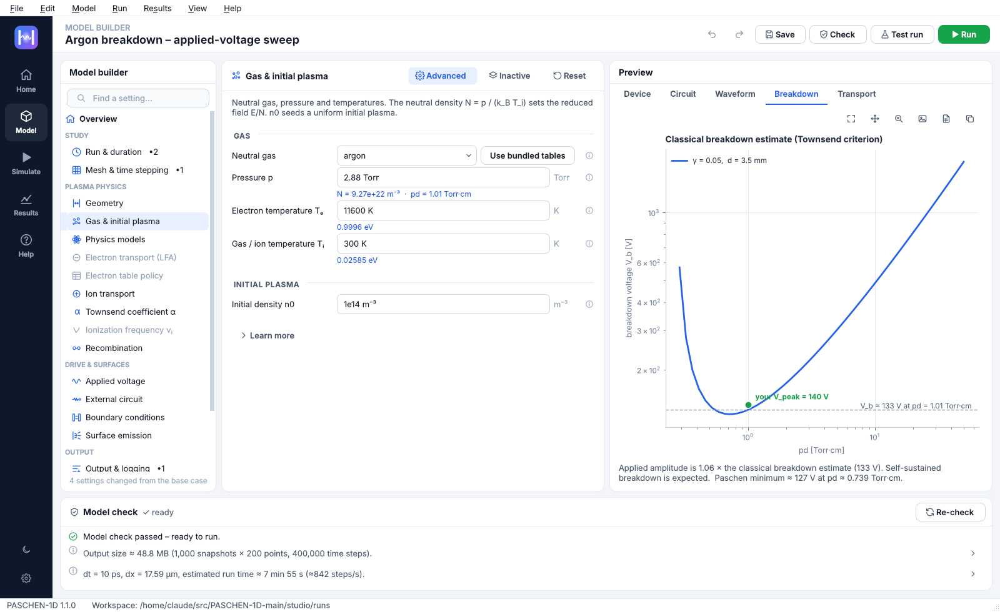

<p align="center"></p>

<h1 align="center">PASCHEN-1D Studio</h1>
<p align="center"><b>Graphical workbench and command line for the
<a href="https://github.com/pbis-umich/PASCHEN-1D">PASCHEN-1D</a> gas-discharge solver</b><br>
Build a model with guided forms · check it · run it with live plots · analyse and export the results – no code required.</p>

<p align="center"></p>

PASCHEN-1D Studio is an **add-on** that lives in its own folder (`studio/`) inside PASCHEN-1D.
It never modifies the solver: it reads PASCHEN-1D's own configuration classes to build its forms and
runs simulations only through the solver's public API (`load_simulation_case`,
`validate_simulation_config`, `run_simulation`). Every run folder is a normal PASCHEN-1D run folder,
so the diagnostics notebooks keep working on it.

## Install

You need **Python 3.10 – 3.13** (3.12 recommended). Everything else (NumPy, SciPy, Matplotlib, Numba, PySide6)
is installed automatically.

```bash
git clone https://github.com/faisal-um-ners/PASCHEN-1D-Temp.git
cd PASCHEN-1D
pip install -e ./studio                  # studio + all solver dependencies
python -m paschen_studio gui             # graphical interface   (or simply: paschen-studio)
```

**One-click alternative** (creates a private environment in `studio/.venv`, checks the installation with a
1-second simulation and adds a launcher):

| System  | Install / start |
|---------|-----------------|
| macOS   | double-click `studio/Launch PASCHEN-1D Studio.command` (first time installs; later it just starts). The installer also creates `studio/PASCHEN-1D Studio.app`. |
| Windows | double-click `studio\Launch PASCHEN-1D Studio.bat` (or run `studio\install\install_windows.bat`). A desktop shortcut is added. |
| Linux   | `bash studio/install/install_mac_linux.sh`, then start from the applications menu or `./studio/launch_studio.sh`. |

The installers look for a suitable Python automatically (python.org, Homebrew, conda/Miniforge, pyenv,
system Python) and rebuild the private environment if it was created with an unsupported Python.

## Command line

```bash
python -m paschen_studio gui                                   # graphical interface
python -m paschen_studio run   studio/examples/nitrogen_dbd_demo.p1d.json      # run a model (live progress bar)
python -m paschen_studio run   model.p1d.json --set waveform.V_peak=180 --test # override settings / quick test
python -m paschen_studio sweep studio/examples/argon_breakdown_sweep.p1d.json  # run the sweep stored in a model
python -m paschen_studio sweep model.p1d.json --param plasma_state.p_Torr --range 1 10 6 --log
python -m paschen_studio check model.p1d.json                  # solver validation + advice
python -m paschen_studio cases                                 # list the PASCHEN-1D case modules
python -m paschen_studio new config_case_argon_dc_discharge my_case.p1d.json
python -m paschen_studio export-script model.p1d.json run_it.py  # plain Python script (e.g. for a cluster)
python -m paschen_studio results                               # list run folders and their status
python -m paschen_studio info                                  # versions, paths, threads
```

`Ctrl+C` during `run` stops the time loop early and still writes the solver's `run_metadata.json`.

## What the studio adds

* **Home page** with the validated PASCHEN-1D cases, a *1-minute demo* and recent models.
* **Guided wizard** – starting case → gas & gap → applied voltage → circuit → emission → resolution → review.
* **Model Builder** – all 18 configuration blocks (~200 settings) generated from the solver's dataclasses, with
  plain-language labels, the solver's own comments as help, unit-aware inputs (`3.5 mm`, `16 pF`, `70 us`,
  `0.4 MOhm`, `inf`), *only the settings that matter for your current choices*, ↺ reset per setting, undo/redo
  and `Ctrl+K` search.
* **Live previews** – gap schematic, circuit diagram of the selected topology with element values, V_app(t),
  classical Paschen / Townsend breakdown estimate with your operating point, and α/N, μN versus E/N – all
  computed with the solver's own functions (empirical equations or BOLSIG+/LXCat tables).
* **Model check** – runs `validate_simulation_config` and adds advice (run time, output size, free disk space,
  stability, gas/closure consistency, emission boundaries) with **one-click fixes** – e.g. *“use the bundled
  BOLSIG+ / LXCat tables for this gas”*.
* **Run queue** – every run in its own process; pause / resume, *stop & keep results*, abort; progress, ETA,
  speed; live density, field, voltage and current plots; numerical-health warnings (NaN, CFL > 1); solver log.
* **Results browser** – Studio runs *and* notebook runs: summary metrics, time histories, profiles with a time
  slider and animation, space–time maps, time-averaged profiles, run comparison, parameter-sweep summaries,
  metadata viewer, CSV export.
* **Publication export** for every plot – PNG / PDF / SVG / EPS at any size, DPI and font size, white or dark.
* **Parameter sweeps** over any numeric setting (linear / log ranges or lists), run in parallel if you want.
* **Light and dark themes**, high-DPI icons, cross-platform (macOS, Windows, Linux).

## Folder layout

```
PASCHEN-1D/                     ← the solver (never modified by the studio)
└── studio/                     ← everything GUI-related
    ├── paschen_studio/         Python package (GUI + CLI + worker)
    ├── examples/               ready-to-run models (*.p1d.json)
    ├── docs/                   user guide, architecture notes, screenshots
    ├── install/                installers and launcher builders
    ├── tests/                  automated tests (python -m pytest studio/tests)
    ├── Launch PASCHEN-1D Studio.command / .bat, launch_studio.sh
    ├── runs/                   default workspace for run outputs (created on first run)
    └── pyproject.toml
```

Python byte-code and Numba caches of the studio's processes are kept in `studio/.cache`, so using the
studio leaves the solver folder untouched.

## Documentation

* [User guide](docs/USER_GUIDE.md) – a tour of every page, the model file format and tips.
* [How it works](docs/ARCHITECTURE.md) – how the studio talks to PASCHEN-1D without changing it.
* In the app: **Help** (F1) shows a quick start, this guide, the PASCHEN-1D tutorial and README.

## Citation

If you use PASCHEN-1D (and this studio) in published work, please cite:

> Asif Iqbal, Yves Heri, Bingqing Wang, Lan Jin, Md Arifuzzaman Faisal, and Peng Zhang,
> “PASCHEN-1D: A one-dimensional fluid plasma solver with multi-mechanism surface emission and flexible
> external circuit coupling”, *Computer Physics Communications* (2026).
> [Journal](https://www.sciencedirect.com/science/article/pii/S0010465526003863) ·
> [arXiv:2608.07721](https://arxiv.org/abs/2608.07721)

## License

Same terms as PASCHEN-1D (see `../LICENSE`): commercial use is not permitted without separate written
permission, and any use must cite the PASCHEN-1D paper.
