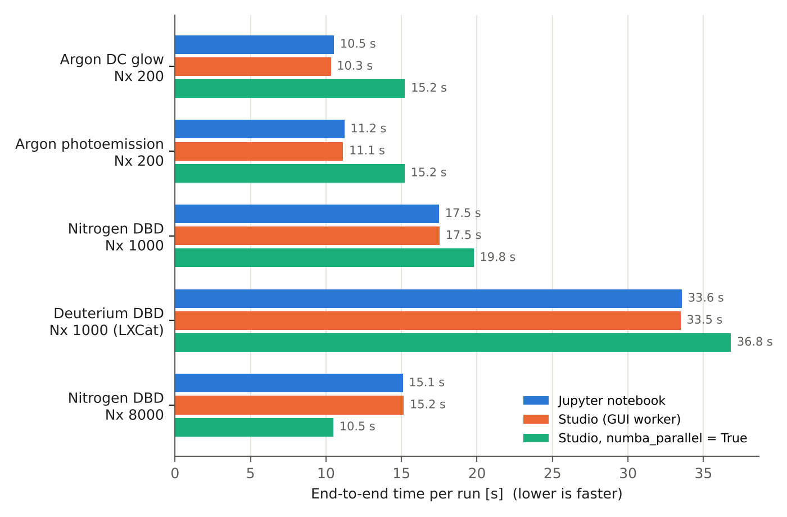
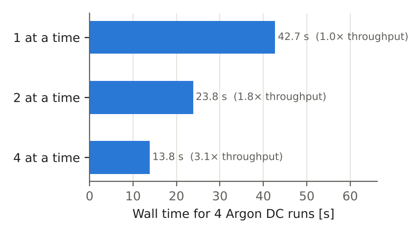

# PASCHEN-1D Studio vs. Jupyter notebook – run-time comparison

*Benchmark date: 29 October 2026 · PASCHEN-1D 1.1.0 · PASCHEN-1D Studio 1.0.0*

## Summary

* **Same speed.** A simulation started from the Studio runs as fast as the same simulation started from
  `run_paschen_1d.ipynb`. Over five workloads the solver's time loop differs by at most 3 % and end-to-end
  time by at most 2 %, which is within run-to-run scatter. Both paths call the same `run_simulation(cfg)`
  with the same Numba kernels; the Studio only adds progress reporting (about one message every 0.2 s)
  and a few small files.
* **The window costs nothing.** Running from the GUI with the live monitor redrawing took the same time
  as the bare worker process (−1 % to +2 %).
* **`numerics.numba_parallel` helps only on fine grids.** It was 1.4× faster at Nx = 8000, but 1.1–1.5×
  *slower* at Nx = 200–1000, where thread start-up outweighs the work per step. Keep it off for the
  shipped cases and turn it on for grids of several thousand cells.
* **The biggest gain is running several simulations at once.** Four independent runs finished 3.1× sooner
  with four running simultaneously (Studio *Preferences → Simultaneous runs*, or a parameter sweep) than
  one after the other, as a single notebook kernel does them.
* **First run after installation** includes Numba compilation: about +1 s. Later runs reuse the
  on-disk cache in both paths.

## Setup

| | |
|---|---|
| Machine | Apple-silicon MacBook (arm64), Linux VM with 4 CPUs and 3 GB RAM |
| Software | Python 3.10.12, NumPy 2.2.6, Numba 0.68.1, 4 Numba threads |
| Notebook path | The run cell of `run_paschen_1d.ipynb` (load the case, set fields on `cfg`, call `run_simulation(cfg)`), executed in a Jupyter kernel via `nbclient` |
| Studio path | Exactly what the **Run** button starts: `python -m paschen_studio.worker job.json` |
| Time loop | The solver's own timer (`Elapsed time …` printed by `run_simulation`) |
| End to end | Notebook: the execution time of the cell (kernel already running). Studio: from launching the worker process to its exit, which includes Python start-up, imports, the run and the summary metrics |
| Repeats | Mean of 3 warm runs (2 for the fine grid); a separate first run with an empty Numba cache |

The workloads are the shipped case modules with their grid and time step unchanged. Only the simulated
time is shortened so that each run takes 10–35 s.

| Workload | Case module | Grid | dt | Steps |
|---|---|---:|---:|---:|
| Argon DC glow | `config_case_argon_dc_discharge` | 200 | 10 ps | 100 000 |
| Argon photoemission (adaptive sub-stepping) | `config_case_argon_photoemission_discharge` | 200 | 8 ps | 80 000 |
| Nitrogen ns-pulse DBD | `config_case_nitrogen_pulsed_discharge` | 1000 | 1 ps | 100 000 |
| Deuterium ns-pulse DBD (LXCat ion tables) | `config_case_deuterium_pulsed_discharge` | 1000 | 1 ps | 100 000 |
| Nitrogen DBD, fine grid | `config_case_nitrogen_pulsed_discharge` | 8000 | 0.1 ps | 20 000 |

## Results

### Studio vs. notebook (serial, `numba_parallel = False`)

| Workload | Time loop, notebook [s] | Time loop, Studio [s] | End to end, notebook [s] | End to end, Studio [s] | Studio vs. notebook | Steps / s |
|---|---:|---:|---:|---:|---:|---:|
| Argon DC glow | 10.3 | 10.0 | 10.5 | 10.3 | −2.0 % | 9 966 |
| Argon photoemission | 7.1 | 7.0 | 11.2 | 11.1 | −0.8 % | 11 387 |
| Nitrogen ns-pulse DBD | 17.2 | 17.2 | 17.5 | 17.5 | +0.2 % | 5 803 |
| Deuterium ns-pulse DBD | 32.7 | 32.6 | 33.6 | 33.5 | −0.3 % | 3 065 |
| Nitrogen DBD, fine grid | 14.9 | 14.9 | 15.1 | 15.2 | +0.4 % | 1 345 |

The standard deviation of repeated runs was 0.03–0.3 s. For photoemission, the gap between time loop and
end-to-end time (≈ 4 s) is the solver precomputing the laser-pulse emission, which is the same in both
paths. The notebook figures exclude kernel start-up (1–2 s, once per session).



### Parallel options

| Workload | Serial [s] | `numba_parallel = True` [s] | Effect |
|---|---:|---:|---|
| Argon DC glow (Nx 200) | 10.3 | 15.2 | 1.5× slower |
| Argon photoemission (Nx 200) | 11.1 | 15.2 | 1.4× slower |
| Nitrogen ns-pulse DBD (Nx 1000) | 17.5 | 19.8 | 1.1× slower |
| Deuterium ns-pulse DBD (Nx 1000) | 33.5 | 36.8 | 1.1× slower |
| Nitrogen DBD, fine grid (Nx 8000) | 15.2 | 10.5 | **1.44× faster** |

Studio end-to-end times are shown; the notebook gave the same values within 2 %.

**Simultaneous runs** (Studio queue, 4 independent Argon DC runs, serial kernels):

| Runs at a time | Wall time [s] | Throughput |
|---:|---:|---:|
| 1 (same as one notebook kernel) | 42.7 | 1.0× |
| 2 | 23.8 | 1.8× |
| 4 | 13.8 | **3.1×** |



### Does the GUI slow a run down?

The same Argon DC model (30 000 steps) was run alternately from the Studio window, with the Simulate page
and live monitor active, and as a bare worker process. The second and third pairs (after compilation)
took 10.1 s vs. 10.3 s and 9.7 s vs. 9.8 s, so there is no measurable overhead. This check ran on a
2-CPU x86 cloud machine (Intel Xeon, Python 3.13); the GUI and the solver run in separate processes, so
more cores only reduce any interference further.

## Recommendations

* Use the Studio or the notebook according to workflow, not speed: the run time is the same.
* Leave `numerics.numba_parallel` off for grids up to about 1000 cells. Try it on fine grids (several
  thousand cells) or long production runs, and compare steps/s from a short **Test run**.
* To use all cores for parameter studies, run several simulations at once: set *Simultaneous runs* to
  about the number of physical cores, or use a parameter sweep. Do not combine this with
  `numba_parallel`, because the threads would compete for the same cores.
* The absolute numbers depend on the machine; the ratios above are what carries over.

## Reproduce

From the PASCHEN-1D folder (Jupyter is used automatically if `nbclient` and `ipykernel` are installed):

```bash
python studio/benchmarks/benchmark_studio_vs_notebook.py --out bench.json
python studio/benchmarks/benchmark_studio_vs_notebook.py --report bench.json   # Markdown table
python studio/benchmarks/benchmark_gui_overhead.py gui_work                     # needs PySide6
python studio/benchmarks/make_figures.py bench.json studio/docs/images          # the two figures
```

`--cases`, `--modes`, `--parallel`, `--repeats`, `--concurrency` and `--scale` select what is run. Raw data
for this report: [`benchmarks/results_apple_silicon_vm.json`](../benchmarks/results_apple_silicon_vm.json),
[`benchmarks/results_gui_overhead_x86.json`](../benchmarks/results_gui_overhead_x86.json). The benchmark
does not modify any solver file: run folders, job files and Numba caches go to a scratch folder.
