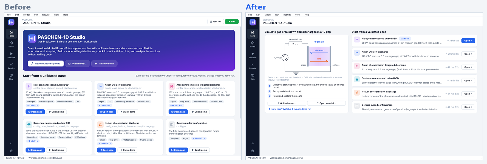
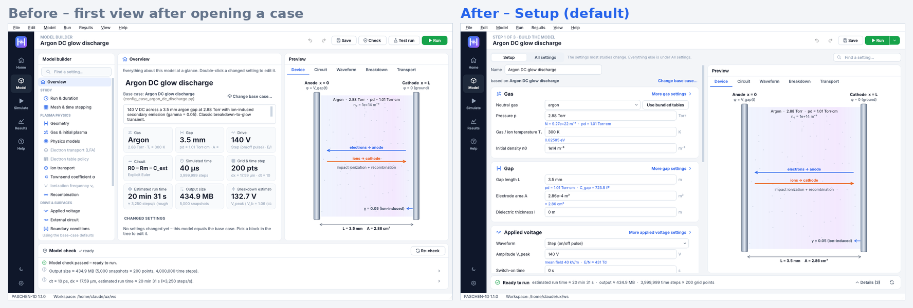
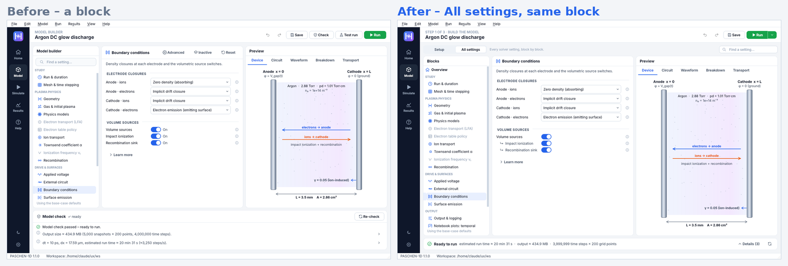
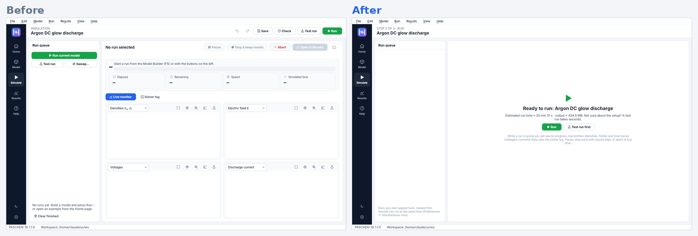

# PASCHEN-1D Studio – usability review and redesign

*PASCHEN-1D Studio 1.1.0 · 29 October 2026*

## Summary

Feedback from a first-time user (Asif Iqbal): the interface *"feels a bit busy, particularly the Home tab and
some of the toggle controls in the Model tab. There is a lot to take in at once, and it is not always clear
where to focus or what to do next."* He asked for a cleaner, more intuitive interface that keeps every
scientific capability. He named four concepts (cognitive load, visual hierarchy, progressive disclosure,
learnability and workflow clarity) and three references: Nielsen's *10 Usability Heuristics*, NN/g's
*Progressive Disclosure* and the Design Council's *Double Diamond*.

The review followed the Double Diamond and went round it twice. The first redesign was checked against the
request and judged **only partly** sufficient, mainly because the Model page was still busy. The second
redesign changed the structure of the Model page:

* **Model: two levels.**
  * **Setup** (default) is one short form in the order a user thinks about the problem: *Gas → Gap → Applied
    voltage → External circuit → Electrodes → Run length & resolution*. It holds 20–24 settings, depending on
    the case, with the live preview beside it and no block tree.
  * **All settings** is every solver block, for experts. Settings the current choices do not use fold behind
    one labelled link per block.
* **Home:** two columns. On the left, a picture of what is simulated, the three steps and two alternatives
  (*Guided setup*, *Open a model*). On the right, the validated cases with a single highlighted *Open*.
* **Simulate:** before a run, a short explanation and one next step; during a run, only the controls that can
  act. Plot tool icons appear when the pointer is over a plot.
* **Everywhere:** the header names the step (*Step x of 3*). Run is one green button whose small menu holds
  Test run, Parameter sweep and Check.

All 208 solver settings, every menu command and every keyboard shortcut remain available (checked
automatically). The PASCHEN-1D solver is unchanged; all work is in `studio/`.

## 1 · Asif's request, point by point

| Point in the feedback | Done? | Where / evidence |
|---|---|---|
| Home tab feels busy | ✔ | Highlighted buttons 8 → 1, visible controls 17 → 9, words on the page 346 → 195. Tags, file names, paragraphs and secondary links were removed or moved to tooltips (§4). |
| Toggle controls in the Model tab | ✔ | The *Advanced / Inactive / Reset* toggle trio on every block is gone. Setup has no view toggles; All settings has one in-place link per block for unused settings. On/Off captions removed; dependent switches indented under their master switch. *Reset block* appears only when the block has changes. |
| "A lot to take in at once" (cognitive load) | ✔ | The Model page opens on one form (no 24-row tree, 3 → 2 panes). Changing pressure, gap, voltage and simulated time takes one form instead of 4 blocks found in a tree. The model check is one line. The empty Simulate page went from 41 controls to 2, and plot toolbars from 24 icons at rest to 0. |
| "Not clear where to focus" (visual hierarchy) | ✔ | One highlighted button per page: *Open* on the recommended case, *Run* on the Model page and the Simulate empty state. Page titles and card titles carry the structure, and secondary text is grey. |
| "Not clear what to do next" (workflow clarity) | ✔ | *Step x of 3* in the header. Home shows the 3 steps. The model-check strip says *Ready to run* or what to fix. The Simulate empty state offers *Run* / *Test run first*, or *Go to the Model page* if there are errors. A finished run offers *Open in Results*. Results with no runs says how to get some. |
| Progressive disclosure | ✔ | Two levels, as NN/g recommends: Setup → All settings, with labelled links (*More gas settings*, *Show 103 settings not used by the current choices*). Expert content is one step away, and search or *Go to* opens the right place. |
| Learnability | ✔ | Setup follows the physical problem, not the solver's code structure. Labels in plain language, with derived values (pd, E/N, dt, run time) under the fields. The "What it simulates" picture explains the model in one glance. Help, quick start and user guide are updated. |
| Preserve all scientific capabilities | ✔ | Automated check: every one of the 208 settings is editable in All settings. Menus and shortcuts are unchanged, and no solver file was touched. |
| Use the three references | ✔ | Nielsen heuristics: full 10-heuristic scorecard (§3). Progressive disclosure: two levels, information scent (§4). Double Diamond: two iterations, alternatives compared (§2). |
| Screenshots of Home, Model, Simulate as input | ✔ | Captured at 1440 × 900 and at the minimum size 1100 × 700, light and dark (before/after images below). |
| Test with users (Double Diamond *Deliver*) | **Open** | Not possible from here. A ready-to-run test plan with tasks and measures is in §7. |

## 2 · Process – Double Diamond, two iterations

| Phase | Iteration 1 | Iteration 2 |
|---|---|---|
| **Discover** | Screenshots of every page. A heuristic walkthrough of the first-use task *open a case → change a setting → run → look at the result*. Counts of controls, highlighted buttons and words per page. | Re-check of iteration 1 against each point of the feedback (§1). Five points were only partly met; the Model page had barely changed (controls 26 → 24). |
| **Define** | 13 findings (F1–F13, §3), each tied to a heuristic and a concept. | 3 new findings: F14 the Model page is ordered by the solver's structure, not the user's task; F15 three equal panes and a 19-block tree still compete; F16 every plot shows 6 tool icons. |
| **Develop** | Options per finding. The Model page got one global *Essentials / All settings* filter over the same tree. | Three Model-page alternatives (below); C was chosen. |
| **Deliver** | Implemented and validated. | Implemented, validated, measured (§5–6). Next: user test (§7). |

**Model page – alternatives considered in iteration 2**

| | Idea | Verdict |
|---|---|---|
| A | Keep the block tree and hide more of it (iteration 1) | Still 3 panes, still 13+ blocks to scan, so cognitive load stays high. Rejected. |
| B | A step-by-step wizard for every edit (staged disclosure) | Good for a first model (the *Guided setup* already does this), but slow for repeated edits and it hides the overview. Rejected for the Model page. |
| **C** | **Two levels: one short task-ordered *Setup* form + preview; *All settings* for experts** | Matches NN/g: few important options first, the rest on request, at most two levels. Keeps editing fast. **Chosen.** |

## 3 · Findings and heuristic scorecard

Severity (Nielsen): 0 = no problem, 1 = cosmetic, 2 = minor, 3 = major. H# = heuristic number.

| # | Page | Finding (before) | Concept · heuristic | Sev. → after |
|---|---|---|---|---|
| F1 | Home | Eight highlighted buttons compete above the fold; nothing says where to start. | Hierarchy · H8 | 3 → 0 |
| F2 | Home | Five starting actions with equal weight (*New simulation – guided*, *Open model*, *1-minute demo*, *Open case*, *Quick demo*). | Cognitive load · H8 | 3 → 1 |
| F3 | Home | *Run* / *Test run* in the header before a model is chosen run a default model the user never saw. | Workflow · H1, H5 | 3 → 0 |
| F4 | Home | Solver file names and up to five tags per card – jargon for a newcomer. | Load · H2, H8 | 2 → 0 |
| F5 | Home | The workflow explanation is below the fold. | Learnability · H6 | 2 → 0 |
| F6 | Model | *Advanced* and *Inactive* toggles on every block; unclear meaning, per-block state to remember. | Disclosure · H4, H6 | 3 → 0 |
| F7 | Model | 24-row tree including unused blocks. | Load · H8 | 2 → 0 in Setup |
| F8 | Model | Redundant *On/Off* captions; dependent switches look independent. | Hierarchy · H2, H8 | 2 → 0 |
| F9 | Model | Model-check panel permanently about 150 px, mostly information-level notes. | Hierarchy · H8 | 2 → 0 |
| F10 | Model | Five equal header actions (*Save, Check, Test run, Run*, undo/redo). | Hierarchy · H8 | 2 → 0 |
| F11 | Simulate | Empty page: four empty plots, "–" tiles, five disabled buttons (41 controls), duplicate run buttons. | Load · H1, H8 | 3 → 0 |
| F12 | All | No indication of where the user is in the workflow or what comes next. | Workflow · H1 | 3 → 0 |
| F13 | Results | With no runs: *"Select a run on the left"* next to an empty list. | Workflow · H1, H9 | 1 → 0 |
| F14 | Model | Settings ordered by the solver's code structure; a simple study needs 4–5 blocks found in the tree. | Learnability · H2, H6 | 3 → 0 |
| F15 | Model | Tree, settings and preview panes compete equally. | Hierarchy · H8 | 2 → 0 |
| F16 | Simulate / Results | Every plot shows 6 tool icons (24 on the Simulate page). | Load · H8 | 2 → 0 |

**Ten-heuristic scorecard** (worst severity of the remaining problems, before → after, all pages):

| # | Heuristic | Before | After | What addresses it |
|---|---|:-:|:-:|---|
| 1 | Visibility of system status | 2 | 0 | *Step x of 3*; the check strip (*Ready to run*, run time, output size); the Simulate empty state; run controls that follow the run state; plot tools stay visible while a mode is on. |
| 2 | Match with the real world | 2 | 0 | Setup ordered gas → gap → voltage → circuit → electrodes → run length; the circuit picture; plain labels; file names out of sight. |
| 3 | User control and freedom | 0 | 0 | Undo/redo, *Reset block*, per-setting reset, Stop & keep results, Cancel everywhere – kept. |
| 4 | Consistency and standards | 2 | 0 | One Run button pattern (green + menu) on the Model page and the queue; one name, "Model page", everywhere; the same link style for every "more" action. |
| 5 | Error prevention | 1 | 0 | No Run before a model is chosen; Run only where the model is visible; the check runs as you type and blocks a run with errors. |
| 6 | Recognition rather than recall | 3 | 0 | No per-block toggle state to remember; the essentials of a study are on one form; derived values (pd, E/N, dt, run time) under the fields. |
| 7 | Flexibility and efficiency | 0 | 0 | All shortcuts kept; *Find a setting* (Ctrl+K) at the top of the Model page; All settings for experts; right-click on plots and case rows. |
| 8 | Aesthetic and minimalist design | 3 | 1 | Less text, one highlight per page, hover-revealed secondary actions. Remaining: the All settings view is still dense by nature – it is the expert level. |
| 9 | Recognise, diagnose, recover from errors | 1 | 0 | A new error opens the check details by itself, with *Fix* buttons and *Go to*; the Simulate page sends you to the Model page when the model cannot run. |
| 10 | Help and documentation | 1 | 0 | Help in place (tooltips, derived values, "Learn more"); quick start, user guide and this review updated. |

## 4 · What changed

### Home (F1–F5, F12)

* Two columns whose tops and bottoms line up.
  * **Left (40 %)**, headed *Simulate gas breakdown and discharges in a 1D gap*: a picture of the model (a
    voltage source V_app(t), an external circuit box (R, L, C), a 1D gas gap between anode and cathode with
    electrons and ions), one line on what is solved, and the three steps (*Choose a starting point → Set up and
    check the model → Run it and explore the results*). At the bottom: *Guided setup…*, *Open a model…*,
    *Recent* (only when there is something to list) and one link for newcomers, *Watch a 1-minute demo run*.
  * **Right (60 %)**, *Start from a validated case*: compact rows with name, one-line summary, estimated run
    time and *Open*. The paper's nitrogen DBD is marked *Start here*, and its *Open* is the only highlighted
    button on the page. *Demo* takes the run-time slot on hover (or via right-click); tags and module names are
    in the row tooltip.
* No Run buttons on Home. The version and folder line moved out: versions are in the status bar and Help → About; the
  solver folder is in Preferences.

### Model (F6–F10, F14, F15)

* **Setup** (default): six cards in the user's order, 20–24 settings depending on the case. Only settings that
  matter for the current choices show (e.g. τ and t_peak only for a Gaussian pulse, R_m only for circuits that
  contain it). Derived values appear under the fields. Hovering a card switches the preview (device, circuit,
  waveform …). Each card has a **More … settings** link to the complete block. The model name and base case are
  on one line at the top.
* **All settings**: the block tree, the block's settings and the preview. Expert options are shown. Settings
  the current choices do not use fold behind one link per block (*Show 103 settings not used by the current
  choices* on *Surface emission*). *Reset block* appears only when there is something to reset. Dependent
  switches are indented with ↳ under their master switch, and the On/Off captions are gone.
* **Find a setting…** (Ctrl+K) at the top right. Search, *Go to* links and model-check fixes open the Setup form
  if the setting is there, otherwise All settings, unfolding unused settings if needed.
* **Model check** is a one-line strip: *Ready to run* (or *N errors*) · estimated run time · output size · steps ×
  grid points. *Details* folds out the findings with *Fix* and *Go to*. It opens by itself on a new error and
  folds away when the error is fixed.
* **Header:** *Undo · Redo · Save · Run ▾*. The arrow holds *Test run* (Shift+F5), *Parameter sweep…*
  (Ctrl+Shift+R) and *Check the model now* (Ctrl+Shift+K).

### Simulate (F11, F16)

* No run yet: **Ready to run: ‹model›** with run time and output size, **Run** and **Test run first**. If the
  model has errors, it says so and offers **Go to the Model page**.
* During a run: Pause / Stop & keep results / Abort. When finished: **Open in Results**. *Run current model ▾* in
  the queue appears once runs exist; *Clear finished* when there is something to clear.
* Plot tools (reset view, pan, zoom, log, export, CSV, copy) appear when the pointer is over a plot and stay while
  a mode is on; right-click offers the same actions. This also applies on the Results page.

### Everywhere (F12, F13)

* The header names the step (*Step 1 of 3 · Build the model*, *Step 2 of 3 · Run*, *Step 3 of 3 · Explore
  results*), and the navigation tooltips say the same.
* Results with no runs: *"No results yet – run a model on the Simulate page …"*.

## 5 · Measurements

Counted in the running application at 1440 × 900, light theme, case *Argon DC glow discharge*. *Controls* are
the buttons, inputs, menus and tabs visible without scrolling, including the header. *Highlighted* buttons are
filled primary or Run buttons. *Words* is the text visible in the window.

| View | Controls | Highlighted | Words | Tree rows |
|---|---:|---:|---:|---:|
| Home | 17 → **9** | 8 → **1** | 266 → **198** (whole page 346 → 195) | – |
| Model, first view after opening a case | 17 → 31 ¹ | 1 → 1 | 188 → **125** | 24 → **0** |
| Model, a block in All settings (5 blocks, mean) | 25 → **23** | 1 → 1 | 112 → **107** | 24 → 24 |
| Simulate, no run yet | 41 → **2** | 4 → **1** | 53 → 95 ² | – |
| Plot tool icons at rest, Simulate page | 24 → **0** | – | – | – |

¹ The old first view was a read-only summary; the settings were one tree click away each. The new first view
*is* the editing form, so its inputs are counted.
² Words added on purpose: the empty page now explains what will happen.

**Task measure.** *Change the pressure, gap length, voltage amplitude and simulated time, then run.*
* Before: find and open 4 blocks in a 24-row tree (*Gas & initial plasma, Geometry, Applied voltage, Run &
  duration*), with the Advanced/Inactive state per block in mind.
* After: one form, top to bottom, and *Run*.

## 6 · Validation

| Check | Result |
|---|---|
| Every one of the 208 solver settings is editable in All settings (automated, per block) | ✔ |
| Setup shows 20–24 settings (three cases) and only those relevant to the current choices (waveform switch tested) | ✔ |
| *More … settings* opens the complete block; *Go to* stays in Setup when possible, otherwise opens All settings and unfolds unused settings | ✔ |
| Menu bar and keyboard shortcuts unchanged; test run, sweep and check reachable from the Run menu | ✔ |
| Behaviour checks (42): Home, both Model views, view memory, reset visibility, indented switches, check strip, Simulate empty and error states, run controls, test run end to end, Results, plot hover tools | 42 / 42 |
| Studio unit tests | 18 / 18 |
| GUI stress test – every page, block and Setup field edited (valid and invalid input), dialogs, runs, results, exports – light and dark theme | 0 errors |
| Minimum window size 1100 × 700 and dark theme | inspected |
| PASCHEN-1D solver files | unchanged |

## 7 · Next: test with new users

The Double Diamond's *Deliver* phase ends with testing on real users. Suggested round: **3–5 people who have not
used Studio**, 20 minutes each, thinking aloud, one facilitator taking notes.

1. *"Run a simulation of a nanosecond-pulsed DBD and read the peak discharge current."*
2. *"Change the gap to 5 mm and the pressure to 100 Torr, make sure the model is fine, then do a test run."*
3. *"Switch on laser photoemission at the cathode."* (needs *More electrodes settings*)
4. *"Compare two runs with different voltages."*

Record task success, time on task and an ease rating per task (1–7). Signs that something still needs work:
hesitation on Home, not finding *More … settings* or *All settings*, or not noticing the check strip. Bring
the findings back into *Discover*.

*References: J. Nielsen, "10 Usability Heuristics for User Interface Design", NN/g (1994, rev. 2024);
J. Nielsen, "Progressive Disclosure", NN/g (2006); Design Council, "Framework for Innovation – the Double
Diamond".*
