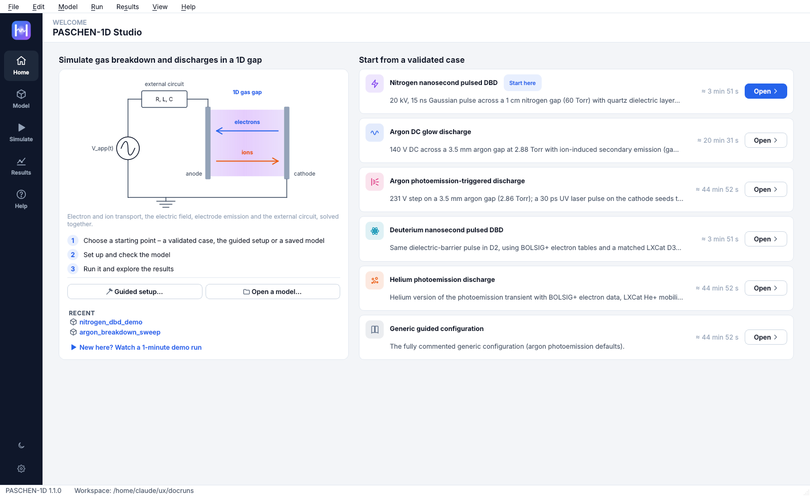
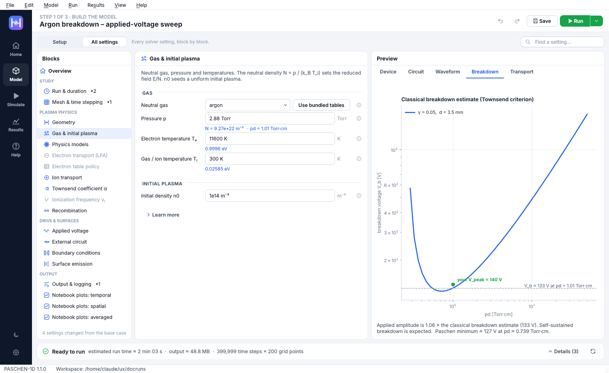
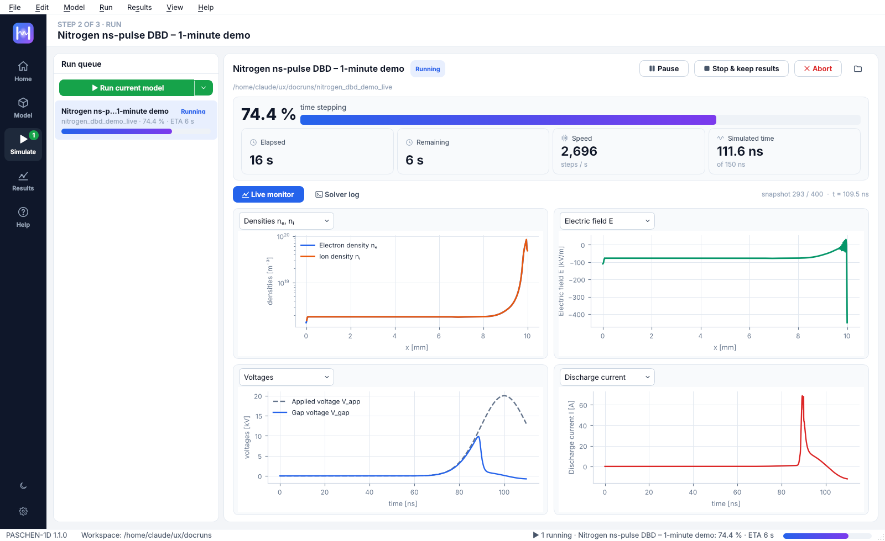
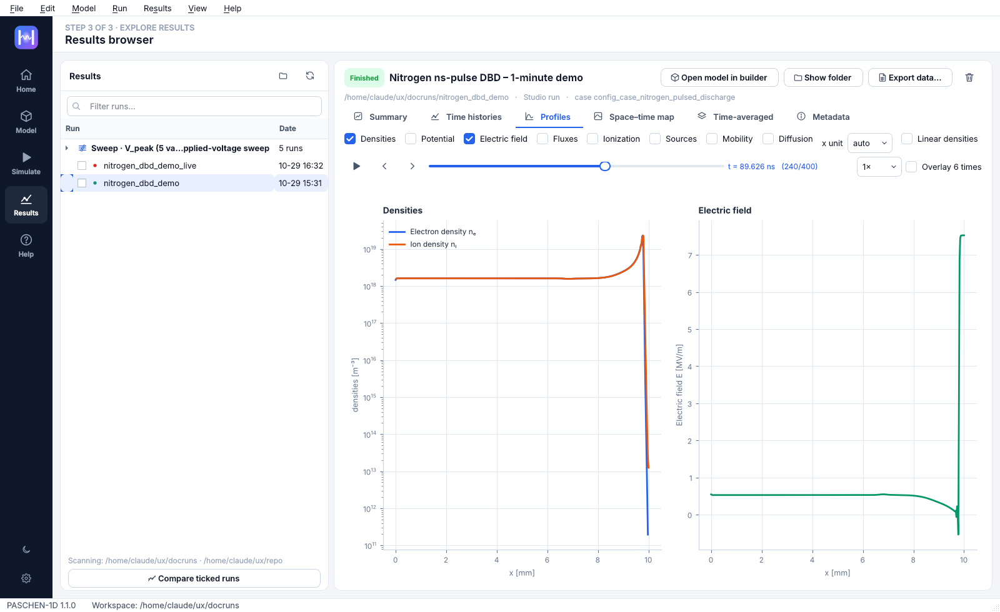

# PASCHEN-1D Studio – User guide

PASCHEN-1D Studio is a desktop application for building, running and analysing
[PASCHEN-1D](https://github.com/pbis-umich/PASCHEN-1D) simulations: a one-dimensional
drift-diffusion–Poisson plasma model with secondary/field/thermionic/photo-emission and lumped external
circuits. This guide walks through every page. Press **F1** in the app for the quick start.

---

## 1. Concepts

| Term | Meaning |
|------|---------|
| **Case** | A PASCHEN-1D configuration module such as `config_case_argon_dc_discharge.py`. Each defines the full `SimulationConfig` with tuned defaults. |
| **Model** | A case + the settings you changed. Saved as a small, readable `*.p1d.json` file. |
| **Run** | One execution of a model. It writes a normal PASCHEN-1D run folder (memory-mapped `*_mm.dat` files + `run_metadata.json`) plus two small studio files (`studio_run.json`, `studio_model.p1d.json`). |
| **Workspace** | The folder that receives run folders (default `studio/runs`, change in *File → Run workspace folder*). |

Because a model only stores *changes*, it stays valid when PASCHEN-1D improves its case defaults, and you
can always see exactly what you changed (Model page → *All settings* → **Overview**).

---

## 2. Home



The Home page has two columns: what the software does on the left, where to start on the right.

* **Left (40 %) – Simulate gas breakdown and discharges in a 1D gap.** A picture of the model: a voltage
  source V_app(t) drives a 1D gas gap between anode and cathode through an external circuit (R, L, C),
  with electrons and ions in the gap. Below it are the **three steps** of the workflow: choose a starting point →
  set up and check the model (**Model** page) → run it and explore the results (**Simulate** and **Results**
  pages). The page header always says which step you are on (*Step 1 of 3 · Build the model* …). At the
  bottom: **Guided setup…** opens the wizard (section 3), **Open a model…** opens a `*.p1d.json` file
  (examples are in `studio/examples`), your **recent** models, and *New here? Watch a 1-minute demo run* – a
  coarse version of the nitrogen nanosecond-pulse DBD that opens the live monitor.
* **Right (60 %) – Start from a validated case** (recommended). One row per PASCHEN-1D case with a one-line
  summary and the estimated run time; hover a row for the full description, tags and module name. Click the
  row or **Open** to load it into the Model page; **Demo** (on hover, or right-click) runs a short version
  immediately. *Start here* marks the paper's nitrogen DBD benchmark, a good first run.

## 3. The guided wizard

1. **Starting point** – pick the closest validated case.
2. **Gas & gap** – gas, pressure, temperature, initial density, gap length, area, dielectric layers.
   The right panel shows the **classical Paschen curve** for your gas and γ with your operating point.
   Choosing a gas without built-in equations (anything other than argon/nitrogen) automatically switches
   electrons to the bundled **BOLSIG+** table and ions to a matching **LXCat** dataset, and turns on adaptive
   sub-stepping when the new transport coefficients need it.
3. **Applied voltage** – waveform type and its parameters with a live V_app(t) preview.
4. **External circuit** – topology and element values with a live circuit diagram.
5. **Surface emission** – γ, the Vaughan model and external emission; only the parameters of the
   mechanisms you switch on are shown.
6. **Duration & resolution** – simulated time, grid, time steps and snapshot cadence with instant estimates
   of dt, dx, run time and output size. Presets: *Quick look*, *Case default*, *Fine*.
7. **Review** – name the model, review the changed settings and the model check; *Create* or *Create & run*.

## 4. Model page

The Model page has two views; the switch at its top left chooses one (the choice is remembered):

* **Setup** (default) – the settings most studies change, as one short form in the order you think about the
  problem: **Gas**, **Gap**, **Applied voltage**, **External circuit**, **Electrodes**, **Run length &
  resolution** – about 20 settings, with the live preview beside them. Only what matters for your choices is
  shown (e.g. τ and t_peak only for a Gaussian pulse, R_m only for circuits that contain it). Each card has a
  **More … settings** link that opens the complete block in *All settings*. Hovering a card shows its preview
  (device, circuit, waveform …).
* **All settings** – every solver setting, block by block: physics closures, boundary conditions, numerical
  scheme, output, notebook-plot defaults and expert options.


**Find a setting…** (`Ctrl+K`, top right) searches every setting by name, meaning or solver comment. Search
results, *Go to* links and the model check open the right place: the Setup form if the setting is there,
otherwise *All settings*. Nothing is out of reach.



**All settings – blocks (left).** The solver's configuration blocks, grouped as *Study*, *Plasma physics*,
*Drive & surfaces*, *Output*. A `•N` badge counts changed settings; grey blocks are not used by your current
choices (hover for the reason); a red icon marks a block with an error. **Overview** at the top summarises the
model: title and notes, gas, gap, drive, circuit, simulated time, the classical breakdown voltage and the table
of changed settings.

**Settings** (the Setup cards and the middle of *All settings*) are generated from the solver's dataclasses:

* Labels in plain language; hover a label (or the ⓘ icon in *All settings*) for the solver's own comment, the
  configuration path (`cfg.circuit.R0`), the type and the case default.
* **Units**: type `3.5 mm`, `16 pF`, `70 us`, `400k`, `0.4 MOhm`, `13.56 MHz`, `1e-11`, `inf` … The field shows
  compact engineering notation and full precision while you edit. Invalid input turns red and explains why.
* A blue left edge and a dot mark changed settings; **↺** resets one setting, **Reset block** (shown only when
  the block has changes) the whole block.
* Switches that depend on another switch are indented under it with **↳** (e.g. *Impact ionization* and
  *Recombination sink* under *Volume sources*; *Cathode emits* under *External emission*).
* **Only relevant settings are shown** – e.g. τ and t_peak only for a Gaussian pulse, R_m only for topologies
  that contain it, laser parameters only when photoemission is enabled, `anode_*`/`cathode_*` parameters only
  in *separate* material mode. *All settings* shows the hidden ones (dimmed, with the reason) and the expert
  knobs (Picard iteration, limiter θ, quadrature grids …).
* Derived values appear under key fields: dt and run time under *Nt*, dx under *Nx*, pd and C_gap under *L*,
  N and pd under *p*, E/N under *V_peak*, number of snapshots and output size under *save_every* …
* **Learn more** (below the settings of a block) shows background notes from the solver's configuration guide;
  long notes wrap to the panel width and diagrams scroll inside their own box.
* Special editors: electron swarm tables (all 42 bundled BOLSIG+ tables, the current gas first), the **ion
  transport library** (818 matched LXCat mobility/diffusion pairs + mobility-only datasets, with plots), and
  **Use bundled tables** for any gas.

**Preview (right, in both views).** Device schematic · circuit diagram (shorted/open elements of the MNA network are shown
as removed) · V_app(t) with laser/emission windows · classical breakdown estimate · Townsend α/N and μN versus
E/N from the solver's own closures with the mean applied E/N marked.

**Model check (bottom strip).** One line says whether the model can run (**Ready to run** or the number of
errors) and what it will cost: estimated run time, output size, time steps × grid points. The check runs
automatically as you edit (the ↻ button re-runs it). **Details** folds out every finding – PASCHEN-1D's
`validate_simulation_config` plus studio advice: free disk space, snapshot count, drift-CFL / diffusion
stability estimate, gas-closure consistency, emission/boundary consistency, existing run folders. Buttons fix
common problems in one click; **›** jumps to the setting. When a new error appears the details open by
themselves, and fold away again once it is fixed.

**Header.** *Undo / Redo*, **Save** and the green **Run** button. The small arrow next to *Run* holds the
variants: **Test run** (`Shift+F5`), **Parameter sweep…** (`Ctrl+Shift+R`) and **Check the model now**
(`Ctrl+Shift+K`). These actions appear on the Model page, where the model is edited.

## 5. Simulate



* Before the first run the page says what it would run – **Ready to run: <model>** with the estimated run
  time – and offers **Run** and **Test run first**. If the model check has errors it says so and offers
  **Go to the Model page** instead.
* **Run** (`F5`) runs the model; **Test run** (`Shift+F5`) runs 2 % of the time steps with the same dt –
  ideal to verify a new setup. Once runs exist, **Run current model** at the top of the queue (its arrow holds
  *Test run* and *Parameter sweep…*) starts more. Runs are queued; set *Preferences → Simultaneous runs* to use
  more cores.
* If the run folder exists you can **keep both** (a new folder name) or **overwrite**.
* Each run is a separate Python process, so the interface stays responsive and several runs can proceed.
* **Pause / Resume**, **Stop & keep results** (ends the time loop; the solver still writes
  `run_metadata.json`, so the partial run is analysable like any other), **Abort** – shown while the run is
  active. When it has finished, **Open in Results** takes you to step 3.
* Progress, ETA, speed and simulated time; the **live monitor** shows two profile plots and two history plots
  (choose the quantities with the drop-downs) refreshed every second, with zoom that survives updates.
* A red banner warns when the solution becomes non-finite or the drift CFL exceeds 1.
* **Solver log** shows everything the solver prints.

## 6. Results



The list contains Studio runs and any PASCHEN-1D run folder (notebook/script runs) in the workspace, the
PASCHEN-1D folder and any extra folders (folder button or *Preferences*). Sweeps are grouped.

* **Summary** – peak current and its time, transferred charge, minimum/final gap voltage, peak electron
  density, run time, grid, max CFL, numerical-health warnings, and four quick plots.
* **Time histories** – tick any saved history (voltages, current components, CFL, Picard iterations, adaptive
  sub-steps …); plots are grouped by unit; optional time window.
* **Profiles** – densities, potential, field, fluxes, ionization, sources, mobilities, diffusion at any
  snapshot: slider, step buttons, **play** (animation at 0.5–8×), *overlay 6 times*, x unit, linear/log.
* **Space–time map** – any spatial quantity as an x–t colour map (log or linear, several colour maps).
  Click the map to open that instant in *Profiles*.
* **Time-averaged** – profiles averaged over a time window.
* **Metadata** – `run_metadata.json`, studio information and the full configuration as a tree.
* **Compare ticked runs** – overlay a history or a final profile of several runs (optionally normalised).
* **Sweep** view – a table of metrics per parameter value, a metric-vs-parameter plot and an overlay of all
  sweep runs.
* **Open model in builder** loads the exact settings of a run; **Export data…** writes histories and final
  profiles as CSV.

## 7. Plots and publication export

Every plot has: reset view (also double-click), pan, zoom-to-rectangle, mouse-wheel zoom, logarithmic y,
**Export figure**, **Export data (CSV)** and **Copy image** (in narrow panels the last three sit under one
export button). The tool icons appear when the pointer is over the plot (they stay while pan, zoom or log is
on); right-click a plot for the same actions. Exported figures are re-rendered with Matplotlib – not screenshots.

**Export figure** opens a dialog with a **live preview** of the file you are about to save; every change is
shown immediately. All fields start from the plot on screen – labels, legend texts, curve colours and styles,
axis scales, the range currently shown and the tick positions – and can be edited:

| Tab | Options |
|---|---|
| Output | PNG, PDF, SVG, EPS or TIFF · single-column, double-column, slide, square or custom size · resolution · white publication, dark presentation or on-screen style |
| Text | Font (sans-serif Arial/Helvetica, serif Times, LaTeX-look Computer Modern, STIX, DejaVu) · font size · default line width · ticks inside/outside · minor ticks · grid · *Typeset all text with LaTeX* (when a LaTeX installation with dvipng is found) |
| Axes | Figure title (multi-panel plots) and panel title – shown only when you type one, otherwise no space is reserved · x label, y label (and right-hand y label, colour-bar label and colour map where present) · linear or logarithmic x and y · range (**Auto** fits the data) · tick positions as a comma-separated list |
| Lines | Colour scheme for all curves (publication, colour-blind safe, Matplotlib, viridis, black & white with line styles) · per curve: legend text, colour (click the swatch), line style (solid, dashed, dotted, dash-dot, none), width, marker and marker size · markers per curve |
| Legend | Show/hide per panel · position (best, any corner or edge, outside right, above the plot) · columns · text size · length of the line sample · gap to the text · row spacing · frame |

Ticks shown in grey are chosen automatically and follow the range and scale; type your own list to fix them
and press **Auto** to go back. Switching an axis to logarithmic picks a whole-decade range covering the data
(at most six decades below the maximum); switching back to linear fits the data again.

Labels accept LaTeX math between dollar signs, for example `$V_\mathrm{gap}$ (kV)`, `$n_e$ [m$^{-3}$]` or
`$E/N$ (Td)`; subscripts in the plot's own labels (V_gap, nₑ, m⁻³) are converted to this form automatically.
If a label contains invalid math the preview says so and *Save* stays disabled until it is fixed.
**Copy** puts the exported figure on the clipboard, **Reset to plot** restores everything taken from the plot.
Your edits are kept when you reopen the dialog for the same plot, and output, font and legend settings are
remembered between exports.

## 8. Parameter sweeps

*Run → Parameter sweep…* (or the arrow next to the Run button): pick any numeric setting, a linear or
logarithmic range or a list of values (units allowed), a run-name prefix and how many runs may execute at
the same time. The sweep is stored in the model, so `python -m paschen_studio sweep model.p1d.json`
repeats it on a workstation or cluster.

## 9. Model files (`*.p1d.json`)

```json
{
  "format": "paschen-studio-model/1",
  "title": "Argon breakdown – applied-voltage sweep",
  "base_case": "config_case_argon_dc_discharge",
  "overrides": { "run.T_total": 4e-06, "numerics.Nt": 400000, "waveform.V_peak": 150.0 },
  "sweep": { "parameter": "waveform.V_peak", "values": [120, 130, 140, 150, 160] }
}
```

Infinite values (e.g. `C_s` in an MNA circuit) are written as `"inf"`. Settings that do not exist in the
installed PASCHEN-1D version are reported and ignored when a model is opened.
*File → Export Python run script* turns a model into a plain script that uses only the PASCHEN-1D API.

## 10. Preferences

Theme (light/dark, also `Ctrl+Shift+D`), run workspace, PASCHEN-1D folder, extra results folders,
simultaneous runs, automatic model checking, live-plot refresh interval.

## 11. Troubleshooting

| Symptom | What to do |
|---------|------------|
| *“PASCHEN-1D was not found”* | Keep `studio/` inside the PASCHEN-1D folder, or choose the folder when asked, or set `PASCHEN1D_HOME`. |
| Installer says no suitable Python | Install Python 3.12 from python.org (macOS/Windows) or your package manager, then run the installer again. |
| A run turns red with *non-finite* | dt is too large for the grid/field: use the model-check fix *Enable adaptive sub-stepping*, increase *Nt*, or start from the case defaults. |
| The first run sits in *setup* for a few seconds | Numba compiles the kernels once; later runs start immediately. |
| Run time estimate is off | Estimates improve automatically after the first finished runs on your computer. |
| A gas other than Ar/N₂ fails validation | Use the one-click fix *Use swarm tables for this gas* (or *Model → Configure transport for the current gas*). |

---

*PASCHEN-1D Studio is an add-on to PASCHEN-1D. Please cite the PASCHEN-1D paper in published work
(Help → Cite PASCHEN-1D).*
